I detail my [Design Decisions](#general-design-decisions) (specifically where I differ from the reference solution) below, as well as my [#Extra Credit](#extra-credit-design-decisions) work here.

Build instructions (these are the normal build instructions):
```bash
mkdir build
cd build
cmake -DCMAKE_BUILD_TYPE=Release ..
make -j8
cd ..
./build/bin/ray # to the run binary from the source directory
```
## General Design Decisions:
### Multithreading:
The `m_threads` variable is set in `main.cpp` and defaults to the number of logical cores. If the json file specifies a number of threads:
```json
{
	"threads": 8
}
```
then `m_threads` will be set to this value. (I have also added a command line flag `-t <thread_count>` to set `m_threads`. It is supported by my binary only and not the reference binary.) My ray tracer has multithreading with OpenMP. The loops in tracePixel and in antialiasing are parallelized with OpenMP compiler directives. 
### Backface Culling
I do **not** implement backface culling, while the reference binary **does** implement backface culling. This causes a discrepancy on the `turtle.json` scene, where one of the trimeshes appears red in the reference binary but black in my solution.
### Pixel centering (in tracePixel and antialiasing):
The reference binary samples at pixel boundaries:  `x = double(i) / buffer_width`, `y = double(j) / buffer_height`.
- For pixel `(i, j)` this gives normalized coordinates `(i/W, j/H)`, which correspond to the top-left corner of the pixel (or the edge between pixel `(i-1)` and `(i)`), not the center of the pixel cell.
So the reference effectively casts one ray per pixel through a corner/edge of the pixel cell. My implementation centers the sample within the pixel:
- **tracePixel:**
`x = (double(i) + 0.5) / buffer_width`,
`y = (double(j) + 0.5) / buffer_height`.
So the single ray for pixel `(i, j)` goes through the center of that pixel’s area in normalized coordinates. Because the reference binary does not use this centering, pixel colors can differ along edges of objects when compared to the reference. Same scene and same resolution will show slight shifts or different edge pixels, especially where a boundary falls between two pixel centers vs two pixel corners.

I do the same pixel centering in my antialiasing methods. More detailed explanations of the extra antialiasing methods are in the extra credit section.
- **Default (supersampling) `aaImage`:**
Subpixel samples are placed at the center of each subcell. For a `gridSize × gridSize` grid over the pixel:
- `offsetX = (double(p) + 0.5) / gridSize`,
- `offsetY = (double(q) + 0.5) / gridSize`,
then `x = (i + offsetX) / buffer_width`, `y = (j + offsetY) / buffer_height`.
	So each of the `gridSize²` samples lies at the center of its subpixel cell, and the pixel is covered by a uniform grid of centered samples. `gridSize` is given by the `m_nSuperSamples` parameter. Default antialiasing is on by default, and can be turned off with the json setting:
```json
{
	"anti_alias": false
}
```
- **Adaptive AA `aaAdaptiveImage` / `aaARecurse`:**
The first level uses the four corners of the pixel (`(i,j)`, `(i+1,j)`, `(i,j+1)`, `(i+1,j+1)` in pixel space) plus the center sample in recursion. So the initial samples are at pixel corners; inside `aaARecurse`, the center of the current quad is always computed as `(x + halfW, y + halfH)`, i.e. the center of that region. So adaptive AA uses corner + center sampling by design for the quadtree, not “all centers” like the default grid.
- **FXAA `aaFastApproxImage`:**
No new rays are cast; it only post-processes the buffer produced by `traceImage`. So “centering” here is whatever was used in `traceImage` (and in the run that feeds FXAA, that is the centered `tracePixel`). FXAA itself only samples and blends existing pixel colors.
### tracePixel and traceRay:
#### tracePixel(i, j):
- Converts pixel indices `(i, j)` to normalized `(x, y)` **at the center of the pixel** (as above).
- Calls `trace(x, y)` to get a color.
- Clamps the result to `[0, 1]` and writes it into the buffer (RGB as `unsigned char`).
- Used by `traceImage`, which runs over all pixels in parallel with OpenMP.
#### traceRay(r, thresh, depth, t):
Given a ray (primary or secondary), computes the color along that ray (direct shading + reflection + refraction), with optional overlap and TIR behavior controlled by flags that I added.
1. **Overlapping translucent objects (handleOverlap):**
If `handleOverlap` is true, the implementation **delegates entirely** to `traceRayOverlap(r, thresh, depth, t, objStack)` with an empty `objStack`. No other branch of `traceRay` is executed. This is explained further in the extra credit section. 
2. **Depth:**
If `depth <= 0`, returns black `(0,0,0)` (recursion limit).
3. **Intersection:**
`scene->intersect(r, i)` finds the first intersection `i` (object, material, normal, `t`, etc.).
4. **If hit:**
- `t = i.getT()` (ray parameter at hit).
- **Direct shading:** `colorC = m.shade(scene.get(), r, i)` — local illumination (diffuse, specular, shadows, etc.).
- **Reflection:** `accumulateReflection(r, i, Kr, thresh, depth, colorC)` adds reflected light (if `Kr > 0`).
- **Refraction:** `accumulateRefraction(r, i, m, Kt, thresh, depth, colorC)` adds transmitted light (if `Kt > 0`), including optional TIR when `tir` is true. This is explained further in the extra credit section.
1. **If no hit:** `t = 0`, `colorC = backgroundColor()` (e.g. black).
2. **Return** `colorC`.
So traceRay is the single place that decides overlap vs non-overlap and then does: intersect → shade → accumulate reflection → accumulate refraction.
### Shading:
`Material::shade` does local Phong (emissive, ambient, diffuse, specular). The base color is just the scene's ambient color combined with the emissive and ambient components of the intersection point. For each light, distance and shadow attenuation and calculated and skipped if effectively zero. They are multipliers on the diffuse and specular term.

Phong shading is defined for opaque surfaces only. For opaque materials, the diffuse reflection is clamped to be greater than 0 (light only when it's on the same side as the normal), for transmissive materials, I take the absolute value so both sides of the surface are diffuse.
- Otherwise, when the camera sees the back of the surface (ex. inside a sphere) the normal can point away from the light and zero out the diffuse term.

The normal is flipped when the light is on the other side, and the reflection vector uses this effective normal so the specular highlight is computed as if the surface faced the light. This way highlights still show on the visible side of glass when the light is behind the surface.
### Light attenuation:
Shadow attenuation for directional and point lights call an overlap function when handling overlapping translucent objects is enabled. This will be explained further in the extra credit section.
### Trimeshes:
I use the barycentric method explained in class.
## Extra Credit Design Decisions:
### Overview:
I implemented many features for extra credit:
What I did in Milestone 1:
1. Total internal reflection. My binary enables this with the `--tir` command line flag. (The reference binary will not support the `--tir` flag.) For example:
	- `./build/bin/ray -r 5 --tir ./ecm1/extra_credit_scenes/trans.json ./ecm1/extra_credit_output/trans.png`
2. Handling physically overlapping translucent objects. My binary enables this with the `--handle-overlap` command line flag. (The reference binary will not support the `--handle-overlap` flag.) For example:
	- `./build/bin/ray -r 5 --handle-overlap ./ecm1/extra_credit_scenes/concentric_spheres.json ./ecm1/extra_credit_output/concentric_spheres.png`
3. Adaptive antialiasing. My binary enables this with the `--aaa` command line flag. (The reference binary will not support the `--aaa` flag.) For example:
	- `./build/bin/ray -r 5 --aaa ./ecm1/extra_credit_scenes/hitchcock.json ./ecm1/extra_credit_output/hitchcock.png`
4. Fast approximate antialiasing. My binary enables this with the `--fxaa` command line flag. (The reference binary will not support the `--fxaa` flag.) For example:
	- `./build/bin/ray -r 5 --fxaa ./ecm1/extra_credit_scenes/hitchcock.json ./ecm1/extra_credit_output/hitchcock.png`
What I did in Milestone 2:
5. Sinc filter for texturing. (Instead of bilinear interpolation).
6. Creative scene.
7. Adaptive ray termination.
8. Stochastic jittered supersampling.
9. Translucent emissive objects.
10. Normal mapping.
11. Portals.
12. Lipschitz-continuous implicit surfaces.
13. Solid volumetric textures.
14. Neural net for antialiasing.
15. Animation, as well as  a trailer.
16. Distributed ray tracing (global illumination).
17. Path tracing.
18. Volumetric ray tracing of participating media.
19. Advanced fresnel and cel shading.
20. Caustics.
### Total Internal Reflection:
Snell's law: $n_{1}\sin(\theta_{1})=n_{2}\sin(\theta_{2}))$
Total internal reflection occurs when we go from a denser to less desnse material, and for a large enough incidence angle, we get that $\sin(\theta_{2})>1$ which is impossible. There is no real refracted ray, the interface reflects all the light. So TIR occurs only when the ray is leaving the denser medium (ex. inside glass, hitting the glass-air boundary) and the angle of incidence is above the critical angle: $\theta_{c}=\arcsin\left( \frac{n_{2}}{n_{1}} \right)$.

When computing the refraction direction (`computeRefractionDirection`), I use the identity $\sin^2(\theta_{transmitted})=\text{iorRatio}^2(1-\cos^2(\theta_{incoming}))$ where the index of refraction ratio is $\frac{n_{1}}{n_{2}}$. Then, if $\sin^2(\theta_{transmitted})>1$, there is no valid refracted direction, so I return a zero vector to indicate that we should take the TIR path when deciding to shoot a refraction ray. So if our refraction direction was a zero vector, and the `--tir` flag is enabled, I compute the reflection direction, trace a reflection ray from the hit point, and attenuate by the path through the material. This logic is implemented also for the `--handle-overlap` path, so you can enable both total internal reflection and handling overlap for a scene.

Here are some examples of my total internal reflection:
1. `trans.json`: My ray tracer with total internal reflection is on the left, the reference solution (which has no total internal reflection) is in the middle. The `trans.json` scene is a given scene, but can also be found in the `extra_credit_scenes` folder. (Again, the scene path is `/ray/extra_credit_scenes/trans.json` and the command to run this, from the `ray` directory is `./build/bin/ray -r 5 --tir ./ecm1/extra_credit_scenes/trans.json ./ecm1/extra_credit_output/trans.png`.)

2. `prism.json`: This is a scene I made and it can be found in the `extra_credit_scenes` folder. It sets up transparent triangular prism in front of the camera: the prism is a 6-vertex trimesh (two triangular bases in the z = ±0.5 planes and three rectangular sides), with a glass-like material (index 1.5, transmissive, some diffuse and specular). It’s rotated around the axis [0.3, 1, 0.2] by 0.85 rad so you look through it at an angle. Two directional lights light the scene. The idea is to show rays that hit the prism’s facets from inside at angles steeper than the critical angle are reflected at the glass–air interface instead of leaving, so with the `--tir` flag you see bright edges along the prism and without it those reflections are missing and the edges stay darker. (Again, the scene path is `/ray/extra_credit_scenes/prism.json` and the command to run this, from the `ray` directory is `./build/bin/ray -r 5 --tir ./ecm1/extra_credit_scenes/prism.json ./ecm1/extra_credit_output/prism.png`.) My ray tracer with total internal reflection is on the left, the reference solution (which has no total internal reflection is in the middle).

### Handling Physically Overlapping Objects:
With overlap on (`--handle-overlap`), the tracer keeps a stack of objects the ray is currently inside; the primary ray starts with an empty stack (air). At each hit it checks whether the hit object is already in the stack. If it is not, the ray is entering that object, so the object is pushed onto the stack and the surface normal is used as-is for refraction. If the object is in the stack, the ray is leaving it, so that object is removed from the stack and the normal is flipped for refraction. So enter/exit is decided only by the stack, not by the dot product. For refraction, the “current” index is the average of the indices of all objects in the stack (empty stack means air, index 1). The “other side” index is the average over the stack after the push or pop. The refraction ratio is current index over other-side index, so at a boundary between two objects you get the correct ratio between their indices. Path attenuation uses the average transmissive color of the set of objects the ray is traveling through (again from the stack). Reflection does not change which objects the ray is inside, so the same stack is passed along. Refraction passes the updated stack (after push or pop) into the recursive call so the next hit sees the correct “current medium.”

Shadow rays with `--handle-overlap` again keep a stack of objects the ray is inside. At each hit, the segment from the previous point to this hit is first attenuated using the average transmissive color of all objects currently in the stack and the segment length; if the stack is empty (air) that step is skipped. Then the hit object is either added to the stack if it was not there (entering) or removed if it was (exiting). So the attenuation for each segment uses the combined effect of every object the ray was inside along that segment, which matches the overlap logic in the raytracer and gives correct colored shadows through stacked objects.

Here are some examples of my overlapping objects:
1. `concentric_spheres.json`: This is a scene I made and it can be found in the `extra_credit_scenes` folder. The scene is three transparent spheres sharing the same center at the origin. The outer one is the unit sphere, the middle is scaled by 0.7, and the inner by 0.4. Each has a different index of refraction (1.1, 1.5, and 2) and a different transmissive tint (reddish, bluish, greenish). The camera looks at them from the positive X side with two directional lights and some ambient. The reference solution does not implement this correctly, and the innermost sphere displaces the middle sphere. My ray tracer does show all three concentric colored spheres equally spaced.
	- `./build/bin/ray -r 5 --handle-overlap ./ecm1/extra_credit_scenes/concentric_spheres.json ./ecm1/extra_credit_output/concentric_spheres.png`

2. `red_blue_spheres.json`: This is a scene I made and it can be found in the `extra_credit_scenes` folder. There are two transparent spheres on a white floor, one has a red transmissive tint and the other has a blue transmissive tint. The spheres overlap physically in the center. The overlapping region should have a combined color and shadow, which the reference solution does not implement.
	- `./build/bin/ray -r 5 --handle-overlap ./ecm1/extra_credit_scenes/red_blue_spheres.json ./ecm1/extra_credit_output/red_blue_spheres.png`
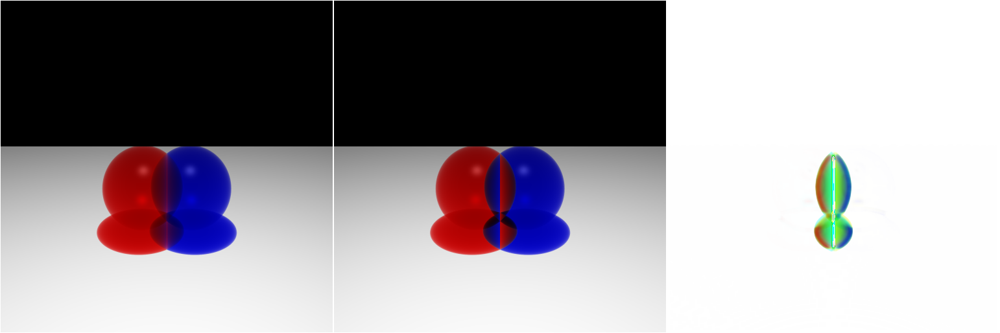
3. `overlapping_shadows.json`: This is a scene I made and it can be found in the `extra_credit_scenes` folder. Two transparent spheres are overlapping, and the scene is meant to stress shadow rays through the overlap. The shadow attenuation should use the combined (averaged) transmissive color of both (not done correctly in the reference implementation).
	- `./build/bin/ray -r 5 --handle-overlap ./ecm1/extra_credit_scenes/overlapping_shadows.json ./ecm1/extra_credit_output/overlapping_shadows.png`
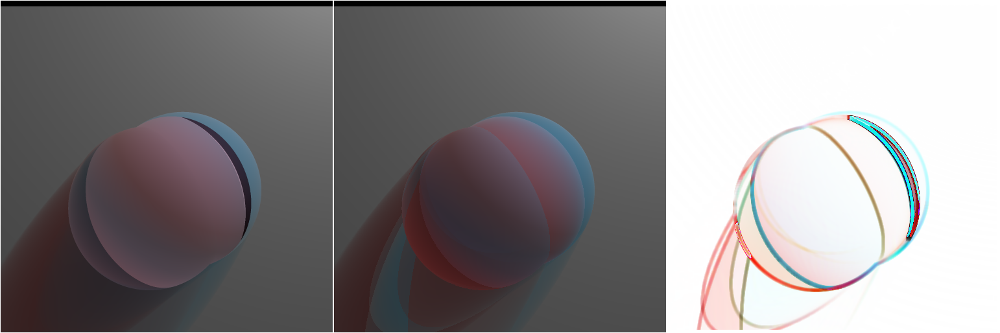
4. `cylinder_box.json`: This is a scene I made and it can be found in the `extra_credit_scenes` folder. There are two overlapping transparent objects, one is a cyan box and the other is a yellow cylinder. Their shadow on the wall behind them should be black, while the overlapping section should be green. The reference solution does not implement the overlap correctly.
	- `./build/bin/ray -r 5 --handle-overlap ./ecm1/extra_credit_scenes/cylinder_box.json ./ecm1/extra_credit_output/cylinder_box.png`
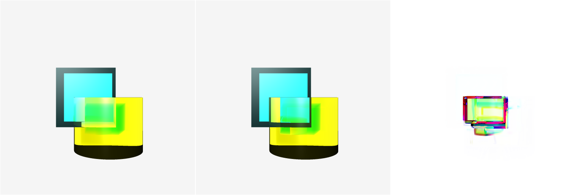
### Advanced Antialiasing Methods
For reference, I ran `hitchcock.json` and `hotel.json` on all my different aliasing methods, these are the baseline (no antialiasing) and default supersampled aliasing results:

`hitchcock.json` without antialiasing:
- `{"anti_alias"=false}` as a `settings.json`
- `./build/bin/ray -r 5 -j settings.json ./ecm1/extra_credit_scenes/hitchcock.json ./ecm1/extra_credit_output/hitchcock.png`
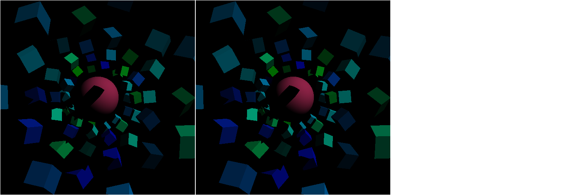
The total time to render my image was 0.54 seconds, and there were ~3.53M rays traced.

`hitchcock.json` with default, supersampled antialiasing:
-  `./build/bin/ray -r 5 ./ecm1/extra_credit_scenes/hitchcock.json ./ecm1/extra_credit_output/hitchcock.png`
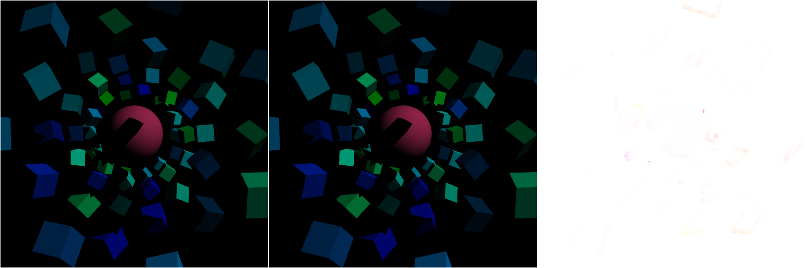
The total time to render my image was 4.07 seconds, and there were ~353K rays traced.

`hotel.json` without antialiasing:
- `{"anti_alias"=false}` as a `settings.json`
- `./build/bin/ray -r 5 -j settings.json ./ecm1/extra_credit_scenes/hotel.json ./ecm1/extra_credit_output/hotel.png`
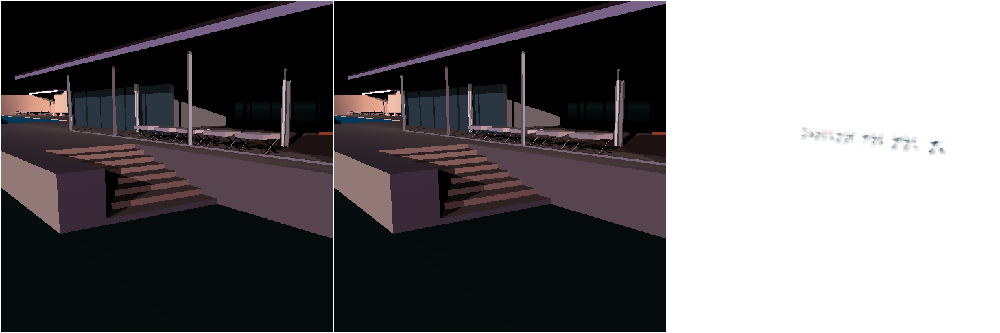
The total time to render my image was 11.9 seconds, and there were ~2.52M rays traced.

`hotel.json` with default, supersampled antialiasing:
-  `./build/bin/ray -r 5 ./ecm1/extra_credit_scenes/hotel.json ./ecm1/extra_credit_output/hotel.png`
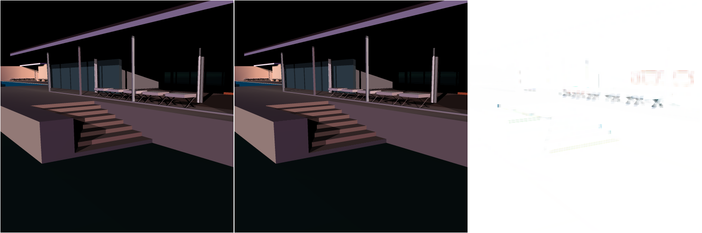
The total time to render my image was 165.86 seconds, and there were ~25.3M rays traced.

#### Adaptive Antialiasing
I set up parallelism by processing the image over rows using OpenMP, treating each pixel (i,j) as an independent 1×1 region in pixel space that I normalize to camera coordinates during ray tracing. I trace rays through the four corners of the pixel to initialize a quadtree subdivision. For each region, I trace a ray through the center (x+w/2,y+h/2) and calculate variation based on the Euclidean distance between the center and corner colors in RGB space. If these distances fall below `aaThresh` or the maximum depth is reached, the average of the five samples is returned (corners plus center); otherwise, I subdivide the region into four quadrants by sampling the edge midpoints, recursively process these subregions using efficient sample reuse, and average their results to produce a final color that I clamp to [0,1] and write to the buffer.

`hitchcock.json` with `--aaa`:
- `./build/bin/ray -r 5 --aaa ./ecm1/extra_credit_scenes/hitchcock.json ./ecm1/extra_credit_output/hitchcock.png`

The total time to render my image was 2.86 seconds, and there were ~2.54M rays traced.

`hotel.json` with `--aaa`:
 - `./build/bin/ray -r 5 --aaa ./ecm1/extra_credit_scenes/hotel.json ./ecm1/extra_credit_output/hotel.png`
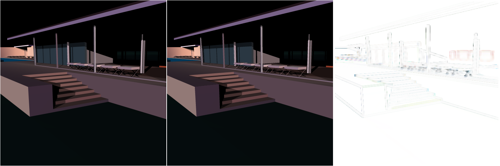
The total time to render my image was 121.40 seconds, and there were ~19.1M rays traced.

#### Fast Approximate Antialiasing
I implement fast approximate antialiasing method as a post-process filter that runs in parallel over the image without casting additional rays. To ensure deterministic results and avoid feedback loops, I first freeze the input by creating a full snapshot of the current RGB buffer; all reads come from this copy while writes go to the original. For every pixel $(i,j)$, I convert the color to floating-point luminance using standard weights ($Y=0.299R+0.587G+0.114B$) (equation from BT.601) and check for edges by gathering a 5-pixel cross neighborhood (center, north, south, east, west). I calculate the local contrast as the difference between the maximum and minimum luminance in this neighborhood ($contrast = Y_{max} - Y_{min}$), and ignore any areas where the contrast falls below a low threshold of approximately $1/255$.

When I detect an edge (where contrast exceeds the threshold), I apply a low-pass filter by averaging the five neighboring colors to create a blurred target: $filtered = (c + c_N + c_S + c_E + c_W) / 5$. I then determine how much to blend this blurred result with the original pixel by calculating a normalized blend factor $b = \frac{contrast}{contrast + threshold}$ (scaled by 0.9), effectively merging the two via linear interpolation: $final = (1-b)c + b \cdot filtered$. Finally, I clamp the result to $[0,1]$ and write it back to the buffer.

`hitchcock.json` with `--fxaa`:
-  `./build/bin/ray -r 5 --fxaa ./ecm1/extra_credit_scenes/hitchcock.json ./ecm1/extra_credit_output/hitchcock.png`
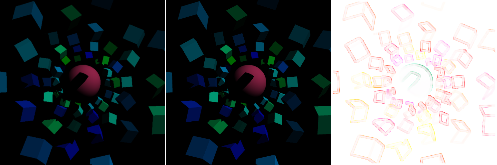
The total time to render my image was 0.63 seconds, and there were ~353K rays traced.

`hotel.json` with `--fxaa`:
-  `./build/bin/ray -r 5 --fxaa ./ecm1/extra_credit_scenes/hotel.json ./ecm1/extra_credit_output/hotel.png`

The total time to render my image was 12.62 seconds, and there were ~2.52M rays traced.
#### Comparison
In the `hitchcock` scene, the efficiency of my implementations is the main differentiator. FXAA is extremely fast (0.63s), taking almost the same amount of time as the raw render (0.54s) because it operates purely as a post-process filter without casting a single extra ray. However, this speed comes at the cost of precision; jagged edges are merely blurred rather than resolved. Supersampling took nearly 8 times longer (4.07s) because it blindly oversamples every pixel. Adaptive Antialiasing provided a middle ground (2.86s), reducing the time needed compared to supersampling, but it was still significantly slower than the post-process approach.

The complex `hotel` scene highlights the scalability of these methods. Supersampling was computationally heavy, taking roughly 166 seconds and casting over 25 million rays to resolve the geometry. My Adaptive method successfully optimized this by pruning flat areas, saving about 45 seconds and 6 million rays compared to the brute-force approach. In contrast, FXAA finished in just 12.6 seconds, barely slower than the base render (11.9s), and kept the ray count identical at 2.52M. While FXAA is the only method that remains fast regardless of scene complexity, it sacrifices the subpixel accuracy that the other aliasing methods provide.

### Sinc Filter
I use a Lanczos2 window, which is a sinc function windowed by a wider sinc function to limit its radius to a range of 2 pixels:
$$L(x) = \begin{cases} \text{sinc}(x) \cdot \text{sinc}(x/2) & \text{if } |x| < 2 \\ 0 & \text{otherwise} \end{cases}$$
Where `sinc` is a normalized sinc function: $\text{sinc}(t) = \frac{\sin(\pi t)}{\pi t}$
Instead of sampling the four nearest neighbors as in bilinear interp, I iterate over a 4x4 pixel window surrounding the sample coordinates and calculate a weight based on the horizontal and vertical distance. The weighted pixel colors are summed and normalized. (A weight sum of zero falls back to the nearest pixel). To test my sinc filter, I created a tiny 4x4 checkerboard (`tiny.bmp`) and ran it with bilinear and sinc filtering (sinc filtering can be enabled via `--sinc`).
Bilinear:

Sinc:

When fed a square wave of alternating pixels, the sinc filter mathematically converts it into a sine wave, which looks like a grid of smooth round blobs. Bilinear, by contrast, draws straight lines between dots, making the checkerboard look boxier.

Commands (from root dir):
```bash
./build/bin/ray -r 5 ./ecm2/extra_credit_scenes/tiny.json tiny_bilin.png
./build/bin/ray -r 5 --sinc ./ecm2/extra_credit_scenes/tiny.json tiny_sinc.png
```
### Creative Scene
My creative scene is an animated, cel shaded dragon going through a portal. Portals, animation, and cel shading are described below, so I will just give the commands to create the frames of the animation as well as embed the animation here.
```bash
./build/bin/ray -r 5 --cel --animation 360 --t-start 0 --t-end 3 ./ecm2/extr
a_credit_scenes/animation/anim_portal_dragon1.json frames/out.png
# To combine the frames into a video I used ffmpeg.
ffmpeg -framerate 30 -i frames/out_%04d.png -c:v libx264 -crf 0 -pix_fmt yuv444p ./ecm2/extra_credit_output/anim_portal_dragon1.mp4
```
I rendered the animation with a cubemap, but since I do not include cubemaps in my tar file I do not include it in the above command. Here is the video of my creative scene! 
### Adaptive Ray Termination
Adaptive ray termination is implemented in recursive ray tracing; instead of tracing a reflection or refraction ray unconditionally, I check the material's coefficient (reflectivity or transmissivity) is below the given threshold. If so, the recursion for that specific branch is terminated early. To invoke a threshold, the settings json must include the key "ray_term_threshold". Ex. to set a threshold of 0.2 (terminating rays if reflection/transmission is less than 20%):
```json
{
	"ray_term_threshold": 200,
	...
}
```
The number is multiplied by 0.001 to determine the actual floating point cutoff.
### Stochastic Jittered Supersampling
I implement stratified sampling by dividing the pixel into a grid and taking one random sample from inside each grid cell. Pixels are divided into NxN grids, where N is the supersampling factor set by `samples`. Coordinate calculation:
$$X_{sample} = \text{Pixel}_x + \frac{p + \text{random}_x}{N}$$  
$$Y_{sample} = \text{Pixel}_y + \frac{q + \text{random}_y}{N}$$
To invoke via the command line, you must include both the `--stochastic` flag and a number of samples `-n 4` (creates a 4x4 grid, 16 samples per pixel). Or via the settings json:
```json
{
	"stochastic_antialiasing": true,
	"supersamples": 4,
	...
}
```
### Translucent Emissive Objects
For translucent objects, the object emits light continuously along the rays path as it travels through the medium. I calculate this via a closed-form solution to the integral of emission attenuated by the material's `k_t` over distance `t`. 
$$\text{IntegratedColor} = \int_0^t L_e \cdot k_t^{(t-s)} \, ds = L_e \frac{k_t^t - 1}{\ln(k_t)}$$
This effect is also applied to shadow rays, meaning these objects cast glowing shadows (colored light) onto other surfaces.
This feature is invoked via the command line flag `--goop`:
```
./build/bin/ray -r 5 --goop ./ecm2/extra_credit_scenes/goop/emissive_sphere.json ./ecm2/extra_credit_output/goop/emissive_sphere.png

./build/bin/ray -r 5 --goop ./ecm2/extra_credit_scenes/goop/goop_lookthrough.json ./ecm2/extra_credit_output/goop/goop_look.png

./build/bin/ray -r 5 --goop ./ecm2/extra_credit_scenes/goop/goop_shadow_emission.json ./ecm2/extra_credit_output/goop/goop_shad.png
```
Here are the scenes rendered from the above commands:

Emissive pink sphere, casts a pink shadow:

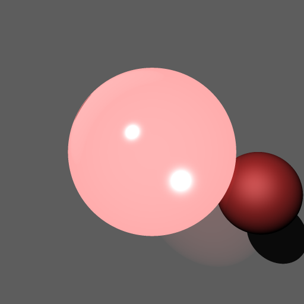

Emissive green sphere, casts a green shadow:

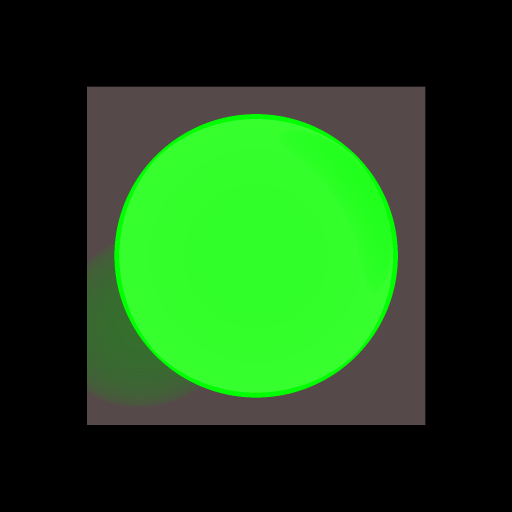

Emissive green sphere, causes a green specular highlight on another object:

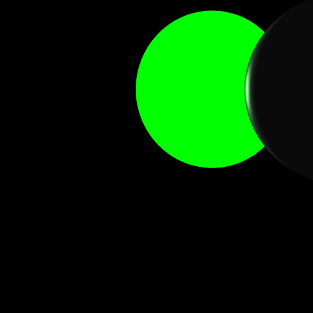
### Normal Mapping
Implemented in the shade function by perturbing the geometric surface normal before lighting calculations. I sample the assigned normal map texture at the current UV coordinates and decodes the RGB color values from the [0,1] range into [−1,1] vector components (XYZ). The X and Y (tangent and bitangent) components are scaled by a `_normalMapStrength` factor to control the bump intensity. A Tangent-Bitangent-Normal (TBN) matrix is constructed using the surface's geometric normal and its partial derivative `dPdu` (with a fallback for degenerate cases like sphere poles). The sampled tangent-space normal is transformed into world space using this basis. Finally, to prevent visible discontinuities at texture edges, the code blends the perturbed normal back toward the geometric normal when UV coordinates are near seams. To invoke: the feature must be enabled via the command line flag `--normal` AND the scene json file must specific a `"normal_map"` key pointing to a texture image path inside a material block.
```bash
./build/bin/ray -r 5 --normal ./ecm2/extra_credit_scenes/normal_map/normal_brick_sphere.json ./ecm2/extra_credit_output/normal_brick_sphere.png

./build/bin/ray -r 5 --normal ./ecm2/extra_credit_scenes/normal_map/normal_stone_box.json ./ecm2/extra_credit_output/normal_stone_box.png
```
Here are the montages comparing my normal mapping to the reference solution for the above scenes!
The reference solution does not support mapping spheres, it seems:

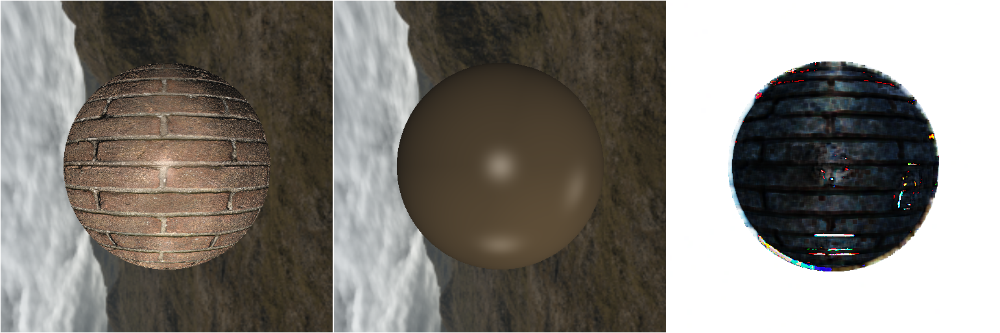

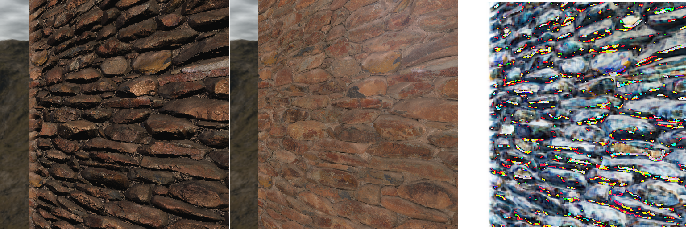
### Portals
Portals are implemented as paired `SceneObject`s (discs) that interrupt the standard ray tracing path. In the primary ray tracing loop (specifically within `intersectPortalAware` or `traceRay`), if a ray intersects a `Portal` object, I bypass standard material shading and instead calculate a "teleportation" step. I compute an exit ray by mapping the intersection point and the incident direction from the entry portal's local coordinate system to the linked partner portal's coordinate system using their transformation matrices. A new recursive trace call is then launched from this exit point with the transformed direction, allowing the ray to continue traversing the scene from the partner's location. To prevent infinite loops (ex., parallel mirrors), I enforce a hard limit on the number of portal traversals (`maxPortalHops`) per ray. Portals are invoked exclusively via the scene json file using the `"portal_pair"` key. This key requires an array containing exactly two objects, where each object defines one end of the portal system (specifying properties like `"radius"` and `"transform"`). 
```bash
./build/bin/ray -r 5 ./ecm2/extra_credit_scenes/portals/portal_dragon4.json ./ecm2/extra_credit_output/portals/pdrag4.png

./build/bin/ray -r 5 ./ecm2/extra_credit_scenes/portals/portal_test.json ./ecm2/extra_credit_output/portals/ptest.png
```
Here are the scenes rendered from the above commands (I render with a cubemap to show the dragon more clearly):

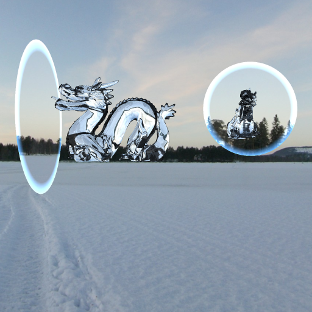

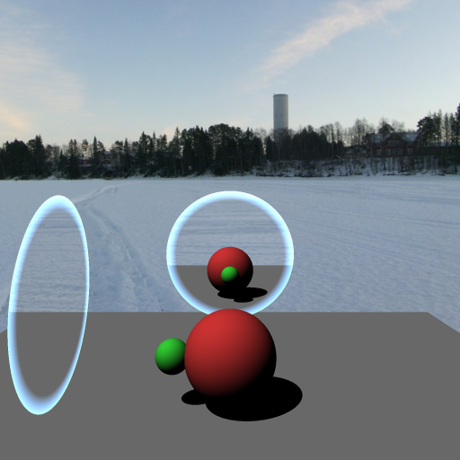
### Solid Volumetric Textures (Procedural Texture Mapping)
I implemented procedural texture mapping using a Reaction-Diffusion system (specifically the Gray-Scott model), which generates organic patterns like spots and stripes dynamically rather than relying on static image files. This is handled by a dedicated texture class that simulates the interaction of two chemical concentrations on a 2D grid over a series of time steps; the resulting concentration map is then sampled using standard UV coordinates during the shading process. This feature is invoked exclusively via the scene json file within a material definition. Instead of using a `"mapped"` image path, you define a `"reaction_diffusion"` object containing specific generation parameters, including `"pattern"` (ex., "spots"), `"iterations"` (to control simulation time), and `"resolution"` (grid size).
```bash
./build/bin/ray -r 5 ./ecm2/extra_credit_scenes/reaction_diffusion/marble.json ./ecm2/extra_credit_output/rd/marble.png

./build/bin/ray -r 5 ./ecm2/extra_credit_scenes/reaction_diffusion/spots.json ./ecm2/extra_credit_output/rd/spots.png

./build/bin/ray -r 5 ./ecm2/extra_credit_scenes/reaction_diffusion/stripes.json ./ecm2/extra_credit_output/rd/stripes.png

./build/bin/ray -r 5 ./ecm2/extra_credit_scenes/reaction_diffusion/wood.json ./ecm2/extra_credit_output/rd/wood.png
```
Here are the scenes rendered from the above commands:

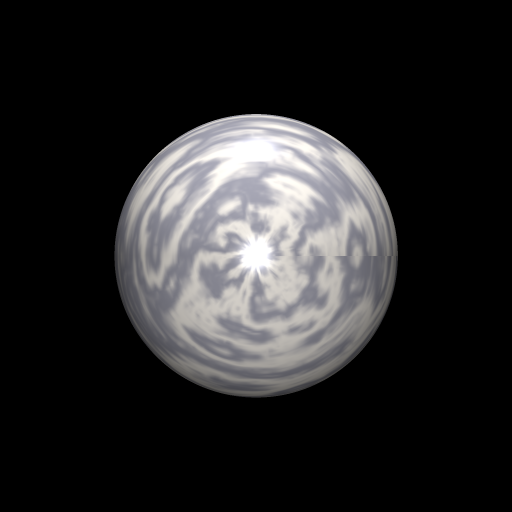

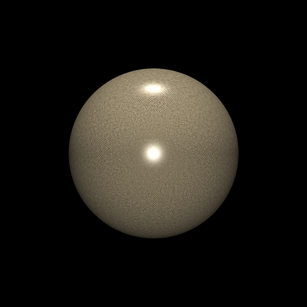

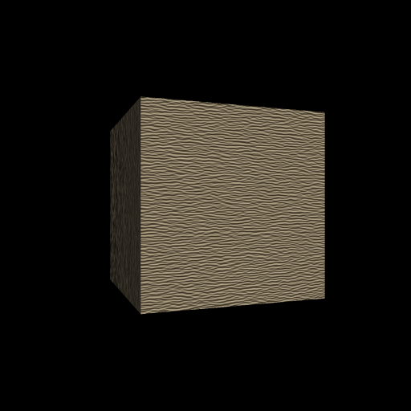

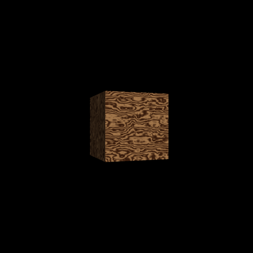
### Lipschitz-continuous Implicit Surfaces
I implemented Lipschitz continuous implicit surfaces using the **Sphere Tracing** (or Ray Marching) algorithm. Within the `ImplicitSurface::intersectLocal` method, I iteratively advance the ray by a safe step size calculated as $∣f(p)∣/L$, where $f(p)$ is the value of the implicit function at the current point and L is the Lipschitz constant (an upper bound on the gradient's magnitude). This ensures the ray converges to the surface zero-crossing without overshooting. I supported various surface types including Spheres, Tori, Goursat Tangles, and Blobs (Metaballs) by defining their specific field functions in `eval()` and their gradient bounds in `lipschitzConstant()`. This feature is invoked via the scene json file by defining a geometry object with the key `"implicit_surface"`. Inside this object, you have to specify the `"type"` (such as `"torus"`, `"goursat"`, or `"blob"`) and the associated parameters for that shape (ex. `"major_radius"`, `"minor_radius"`, or `"lipschitz_constant"`).
```bash
./build/bin/ray -r 5 ./ecm2/extra_credit_scenes/implicit_surfaces/blob.json ./ecm2/extra_credit_output/imp_surf/blob.png

./build/bin/ray -r 5 ./ecm2/extra_credit_scenes/implicit_surfaces/goursat.json ./ecm2/extra_credit_output/imp_surf/goursat.png

./build/bin/ray -r 5 ./ecm2/extra_credit_scenes/implicit_surfaces/sphere.json ./ecm2/extra_credit_output/imp_surf/sphere.png

./build/bin/ray -r 5 ./ecm2/extra_credit_scenes/implicit_surfaces/torus.json ./ecm2/extra_credit_output/imp_surf/torus.png
```
Here are the scenes rendered from the above commands. I use a cubemap to show the shapes more clearly:

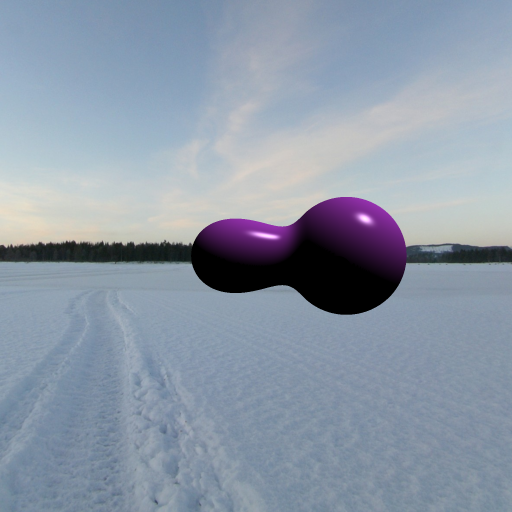

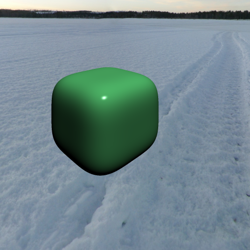

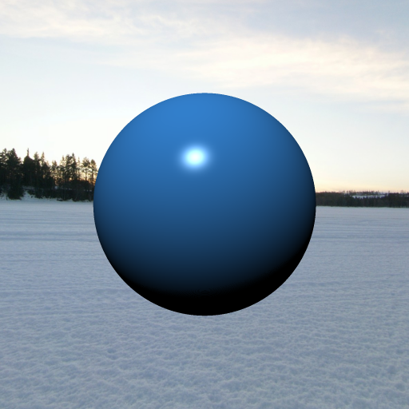

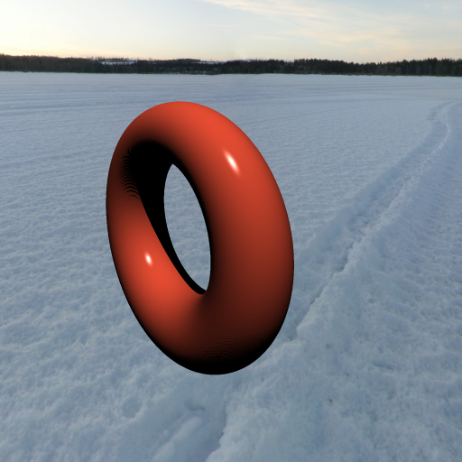
### Neural Net for Antialiasing (Upsampling)
I implemented neural network antialiasing by training a deep learning model (utilizing VGG16-based perceptual loss and sobel edge loss) to learn the mapping between aliased and antialiased images, which I then exported to the ONNX format. Within the renderer's `aaNeuralImage` function, I integrated the ONNX Runtime C++ API to load this model (`neural_aa_best.onnx`) and perform inference as a post-processing step; this involves converting the raw pixel buffer into a normalized NCHW float tensor, running the model, and clamping the output back into the image buffer. Invoked via the command line `--neural flag`.

```bash
./build/bin/ray -r 5 --neural ./ecm1/extra_credit_scenes/hotel.json ./ecm2/extra_credit_output/neural_aa_hotel.png
```

Here I compare render time and image quality for large scenes like hotel, dragon, etc. I use montages because the reference solution is using fully supersampled anti aliasing (which is the ground truth). Hotel was part of the training set, but dragon 4 was not (they were in the testing set). I also only trained/tested/validated on half of the cubemaps, of which iceriver (used below) was not one of. The full training script is at `./src/nn/train.py`.

Time to render hotel with neural aa: 3.17 seconds

Time to render reference with fully supersampled aa: 4.62 seconds

Montage (I do not see a visual difference):

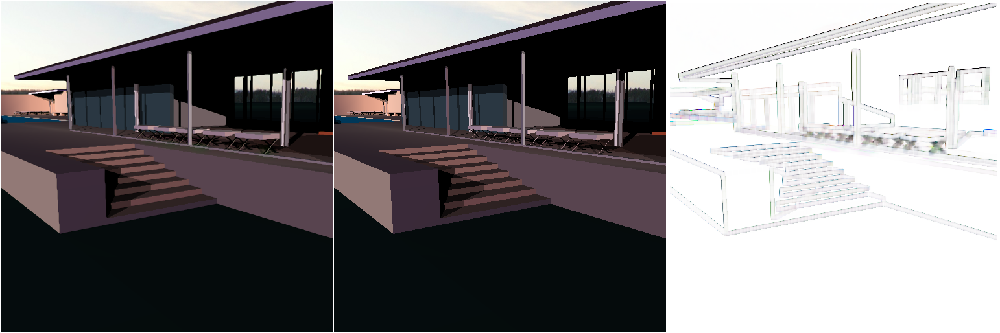

Time to render scenes 2, dragon 4 with neural aa: 1.81 seconds

Time to render reference with fully supersampled aa: 1.97 seconds

Montage (there is a visual difference in that mine is darker, but I think this is also because of design decisions in my ray tracer):

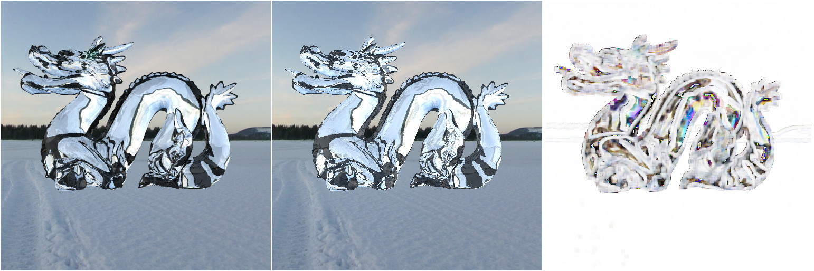

### Animation
I implemented animation by creating a dedicated render loop in the command- line interface that dynamically modifies the scene's json definition for every frame before rendering. Inside `CommandLineUI::runAnimation`, I calculate a current time value t (interpolated between the start and end times) and pass the raw JSON object to a `substituteExpressions` function. This function recursively traverses the JSON tree, identifying string values that represent mathematical expressions (containing variables like t) and evaluates them to produce concrete numeric values for that specific frame. This feature is invoked via the command line using the arguments `--animation <N>` (to set the number of frames), `--t-start <val>`, and `--t-end <val>`, while the scene json itself must use expression strings (e.g., `"rotate": [[0,1,0], "360*t"]`) instead of static numbers for any properties that should change over time.
```bash
./build/bin/ray -r 5 --animation 24 --t-start 0 --t-end 6.28318 ./ecm2/extra_credit_scenes/animation/orbiting_camera.json ./ecm2/extra_credit_output/frames/orbit.png

./build/bin/ray -r 5 --animation 24 --t-start 0 --t-end 6.28318 ./ecm2/extra_credit_scenes/animation/sine_wave.json ./ecm2/extra_credit_output/frames2/sine.png
```
The above command will put all frames into a directory (frames, frames2), which you can make into a video using ffmpeg.
Here are links to the videos I created with my animation:


#### Trailer
I animated a bunch of scenes, all of them are produced by my ray tracer (except for the text!). The scenes are: a camera rotating with an obj mesh of sofia the first (found on [sketchfab here](https://sketchfab.com/3d-models/sofia-sofia-the-first-2112c438c1474694a762b51ae40d523a)), a camera panning up to participating media (volumetric ray tracing), zooming in via the camera field of view, a cel/cartoon shaded dragon going through a portal, path traced color changing caustics, and the end scene is just sofia rotating again. Also music is the sofia the first theme song because I made this into a lyric video LOL. I hope you think it's funny :)

link to ray tracing trailer on youtube:
### Distributed Ray Tracing
I implemented distributed ray tracing by utilizing Monte Carlo integration to average multiple stochastic samples, allowing for effects like global illumination, depth of field, and motion blur. Specifically, I added the `computeIndirectIllumination` function in `RayTracer.cpp`, which casts cosine-weighted rays over a hemisphere to capture diffuse color bleeding and specular inter-reflections. Additionally, I modified the primary ray generation logic to average samples taken from a lens aperture (for depth of field) and accumulated pixel colors across different time steps (for motion blur). Invoked via the command line using the flag `--distributed` or by setting the key `"tracer"` to `"distributed"` in the settings JSON file. There are other parameters like `"global_illumination_samples"` in the settings json or camera properties like `"f_number"` and `"shutter_open"` within the scene json file.
```bash
./build/bin/ray -r 5 --distributed ./ecm2/extra_credit_scenes/global_ill_path/cornell.json ./ecm2/extra_credit_output/dist/cornell.png

./build/bin/ray -r 5 --distributed ./ecm2/extra_credit_scenes/global_ill_path/dof.json ./ecm2/extra_credit_output/dist/dof.png

./build/bin/ray -r 5 --distributed ./ecm2/extra_credit_scenes/global_ill_path/gloss.json ./ecm2/extra_credit_output/dist/gloss.png

./build/bin/ray -r 5 --distributed ./ecm2/extra_credit_scenes/global_ill_path/motion.json ./ecm2/extra_credit_output/dist/motion.png

./build/bin/ray -r 5 --distributed ./ecm2/extra_credit_scenes/global_ill_path/soft_shad.json ./ecm2/extra_credit_output/dist/shadow.png
```
Here are the scenes I rendered with distributed ray tracing. The quality is low because I could not use many samples or it would take a very long time to render. Path tracing is quicker and gets me higher quality images (see below). In these scenes, I showcase depth of field, motion blur, and soft shadows from area lights (I implement area lights as a radius from which I sample many point lights from).

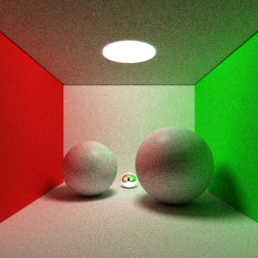


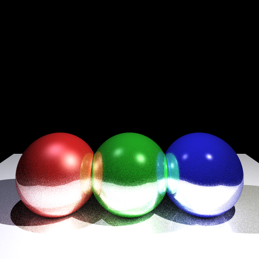

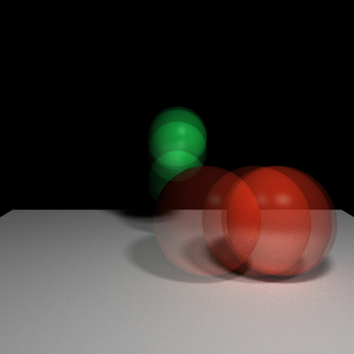

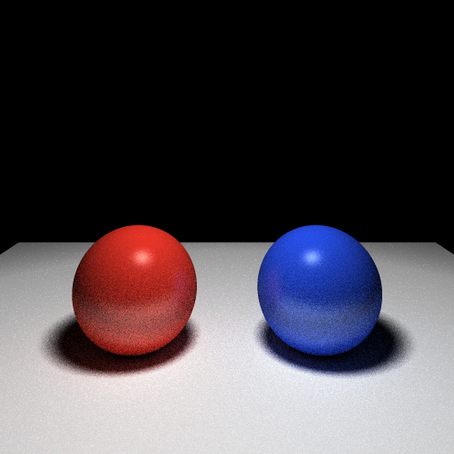
### Path Tracing
I implemented full path ray tracing using a Monte Carlo integration approach with Next Event Estimation (NEE) to accelerate convergence. In the `RayTracer::tracePathRay` function, I perform an iterative random walk for each pixel sample: at every bounce, I explicitly sample light sources (shadow rays) to calculate direct lighting and then use importance sampling (based on the material's BRDF) to choose a new random direction for the indirect light contribution. To prevent infinite recursion and ensure unbiased termination, I applied Russian Roulette after the third bounce, randomly terminating paths based on their current throughput. Invoked via the `--path` flag and quality can be controlled by specifying samples per pixel with `--spp <n>`.
```bash
./build/bin/ray -r 5 --path ./ecm2/extra_credit_scenes/global_ill_path/cornell.json ./ecm2/extra_credit_output/path/cornell.png

./build/bin/ray -r 5 --path ./ecm2/extra_credit_scenes/global_ill_path/dof.json ./ecm2/extra_credit_output/path/dof.png

./build/bin/ray -r 5 --path ./ecm2/extra_credit_scenes/global_ill_path/gloss.json ./ecm2/extra_credit_output/path/gloss.png

./build/bin/ray -r 5 --path ./ecm2/extra_credit_scenes/global_ill_path/motion.json ./ecm2/extra_credit_output/path/motion.png

./build/bin/ray -r 5 --path ./ecm2/extra_credit_scenes/global_ill_path/soft_shad.json ./ecm2/extra_credit_output/path/shadow.png
```
Here are the same scenes from distributed ray tracing rendered with path tracing, you can see the color bleed in the cornell box!

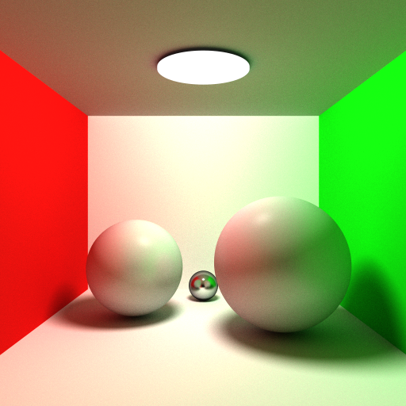

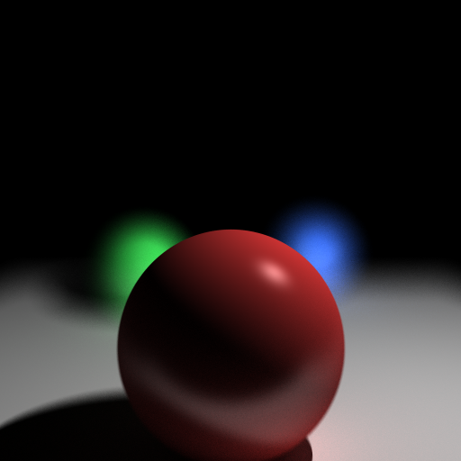

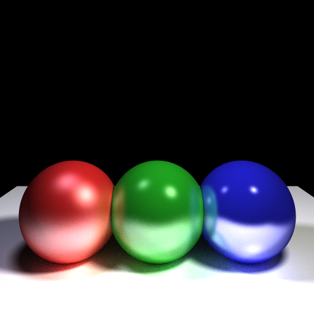

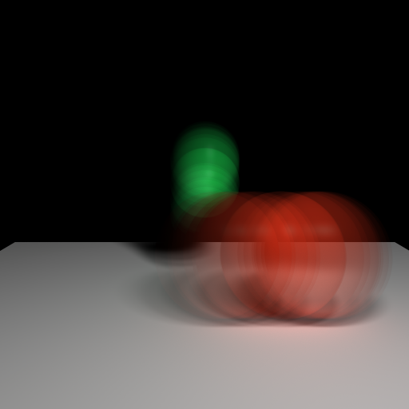

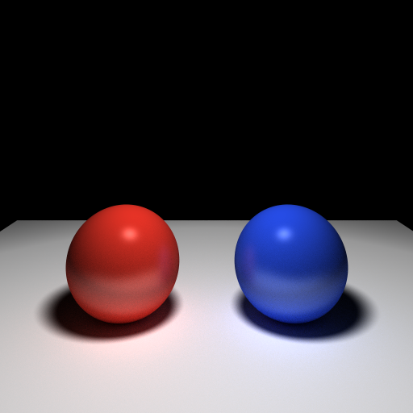
### Volumetric Ray Tracing
I implemented solid volumetric textures (procedural 3D noise) by integrating a Fractional Brownian Motion (fBm) noise function directly into the volumetric ray marching loop. Inside the `RayTracer::traceVolumetric` function (specifically within the helper `sampleVolumeDensity`), I sample `glm::perlin` noise based on the ray's current 3D world position rather than 2D UV coordinates. This noise value is accumulated over multiple octaves in `fbmDensity` and used to modulate the local density of the participating medium, allowing for the rendering of heterogeneous solid volumes like smoke, clouds, or uneven fog. It's invoked through the scene json within a material. To enable it, add a `"volume"` object to the material and set the `"noise_scale"` parameter to a value greater than 0. The texture's appearance can be modified via `"noise_octaves"` (integer) and `"noise_gain"` (float) within the same volume block.
```bash
./build/bin/ray -r 5 ./ecm2/extra_credit_scenes/volumetric/fog.json ./ecm2/extra_credit_output/volumetric/fog.png

./build/bin/ray -r 5 ./ecm2/extra_credit_scenes/volumetric/smoke.json ./ecm2/extra_credit_output/volumetric/smoke.png

./build/bin/ray -r 5 ./ecm2/extra_credit_scenes/volumetric/nebula.json ./ecm2/extra_credit_output/volumetric/nebula.png
```
Here are the scenes rendered from the above commands, although note that these commands do take a while to run! I render with a cubemap to show the media better.

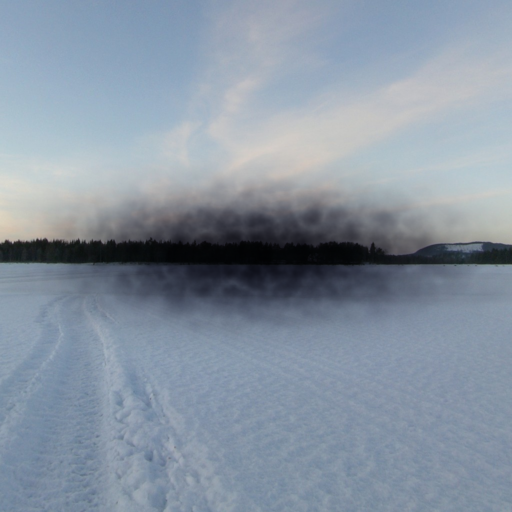

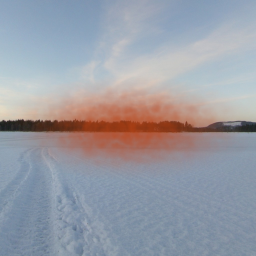

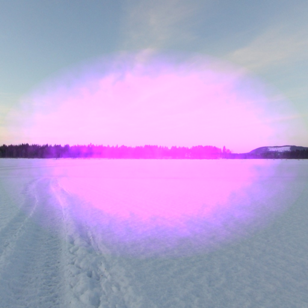
### Advanced Shading
#### Fresnel Shading with Anisotropy
I implemented fresnel shading with anisotropy by integrating a Cook-Torrance microfacet BRDF that utilizes the GGX normal distribution function. In the Material::shade method, I handle anisotropy by splitting the surface roughness into two directional components ($\alpha_x$ and $\alpha_y$) based on an aspect ratio derived from the material's anisotropy factor ($\sqrt{1 - 0.9 \cdot \text{anisotropy}}$). I construct a local tangent frame ($T, B, N$) using the surface's partial derivatives (dPdu) and evaluate the anisotropic distribution function based on the dot products of the half-vector $H$ with the tangent and bitangent vectors. I also implemented a metallic workflow where the Fresnel reflectance term ($F_0$) is interpolated between a standard dielectric base (0.04) and the material's specular color based on a metallic parameter. To invoke use the `--fresnel` flag. The specific surface properties are then defined per-object in the scene json file within the "material" block using the keys "anisotropy" (a float value, typically -1.0 to 1.0) and "metallic" (a float between 0.0 and 1.0).
```bash
./build/bin/ray -r 8 -c /u/krisub/graphics/p1/cubemaps/cubemap_iceriver/negx.png ./ecm2/extra_credit_scenes/adv_shading/fresnel_rim.json ./ecm2/extra_credit_output/adv_shading/no_fresnel_rim.png

./build/bin/ray -r 8 --fresnel -c <INSERT_PATH_TO_CUBEMAP> ./ecm2/extra_credit_scenes/adv_shading/fresnel_rim.json ./ecm2/extra_credit_output/adv_shading/with_fresnel_rim.png

./build/bin/ray -r 8 ./ecm2/extra_credit_scenes/adv_shading/anisotropic_test.json ./ecm2/extra_credit_output/adv_shading/no_anisotropic_test.png

./build/bin/ray -r 8 --fresnel ./ecm2/extra_credit_scenes/adv_shading/anisotropic_test.json ./ecm2/extra_credit_output/adv_shading/with_anisotropic_test.png

./build/bin/ray -r 8 ./ecm2/extra_credit_scenes/adv_shading/anisotropic_cyl.json ./ecm2/extra_credit_output/adv_shading/no_anisotropic_cyl.png

./build/bin/ray -r 8 --fresnel ./ecm2/extra_credit_scenes/adv_shading/anisotropic_cyl.json ./ecm2/extra_credit_output/adv_shading/with_anisotropic_cyl.png
```
Here are the scenes rendered from the above commands. Note that the fresnel rim test case MUST be rendered with a cubemap because the sphere is dark and requires environment light to see the rim.

Sphere without fresnel shading:

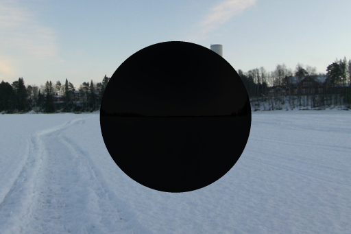

Sphere with fresnel shading, you can see the reflective rim:


Metallic spheres without fresnel shading:

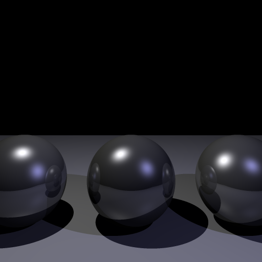

Metallic spheres with fresnel shading. From left to right, decreasing levels of anisotropy, visible in the spread of the highlight:

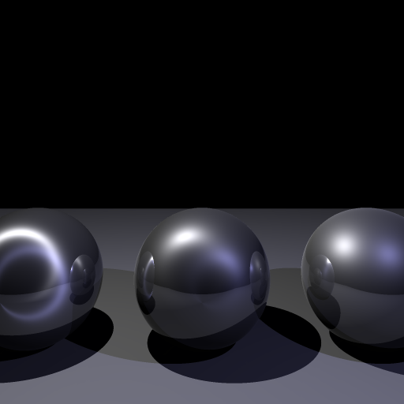

Cylinder without fresnel shading:

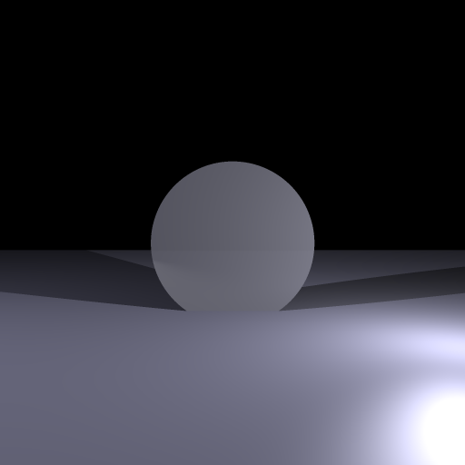

Cylinder with anisotropy and fresnel shading has a long, stretched highlight:

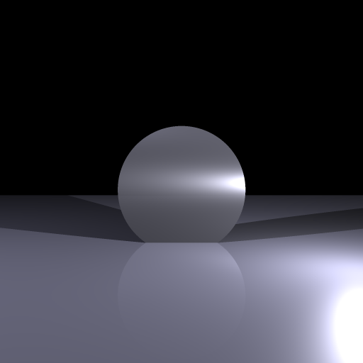
#### Cel Shading
I implemented cel shading (cartoon shading) as a post illumination quantization step at the end of the `Material::shade` function. After calculating the standard Phong color (emissive + ambient + diffuse + specular), I convert the result from RGB to the HSL (Hue, Saturation, Lightness) color space. I then discretize the lightness component into a set number of steps ("bins") using the formula `ceil(L * bins) / bins`, which snaps smooth gradients into flat bands of color, before converting the value back to RGB. Invoke via the `--cel` flag.
```bash
./build/bin/ray -r 5 --cel ./ecm2/extra_credit_scenes/cone.json ./ecm2/extra_credit_output/cel_cone.png
```
Here are a few montages of using cel shading (I use the above scenes)! I also cel shade the background cubemap here, and I implemented a feature for my animated trailed where obj meshes can be excluded from being cel shaded if specified in the scene json. I only put one command above as an example (because otherwise I have to include given scenes in my tar), but you can run any scene with cel shading, just add the `--cel` flag!

cone:
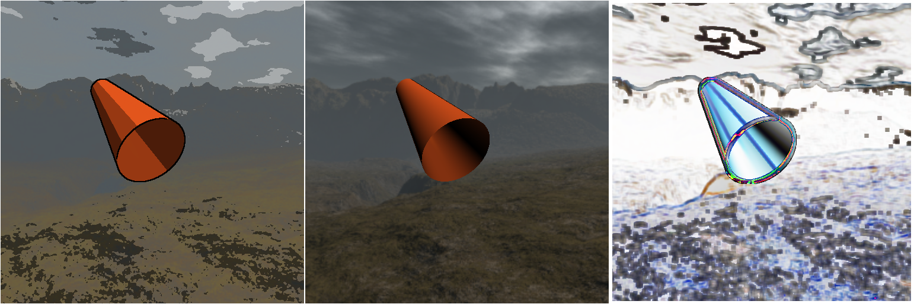

hitchcock:
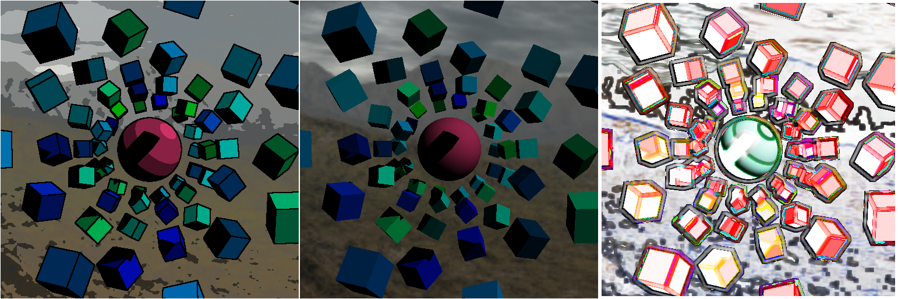

reflection:
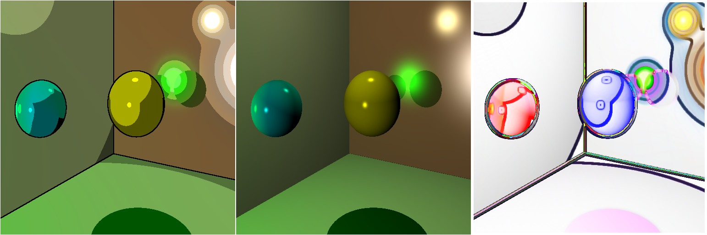

hotel:
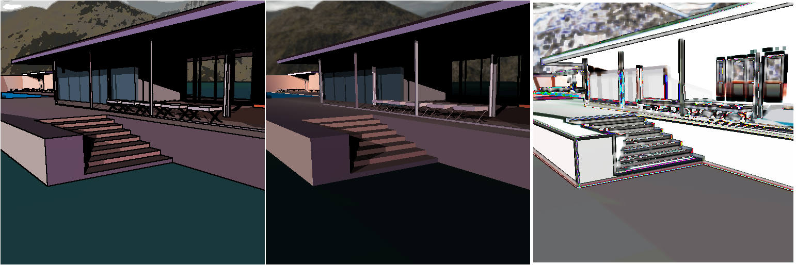
### Caustics
I implemented caustics using photon mapping to capture focused light patterns like those seen through glass. In the `RayTracer::emitCausticPhotons` function, I selectively target specular objects (detected via their bounding boxes and material properties) and emit photons from light sources towards them to maximize sampling efficiency. These photons are traced through the scene, and if they reflect or refract off a specular surface before hitting a diffuse one, they are stored in a kd tree (`PhotonMap`). During the rendering phase (within `tracePathRay` or `Material::shade`), I calculate the caustic contribution at a given intersection point by performing a k nearest neighbor search in the photon map to estimate the local photon density (irradiance). This feature is invoked using the flags `--caustic-photons <N>` (to set the number of photons), `--caustic-radius <R>` (the search radius for density estimation), and `--caustic-gather <K>` (the maximum number of photons to gather). Also requires the renderer to be in path tracing (`--path`) or distributed (`--distributed`) mode to function.
```bash
./build/bin/ray -r 8 --path --caustic-photons 1000000 --caustic-radius 0.5 --caustic-gather 200 ./ecm2/extra_credit_scenes/caustics/glass_ball.json ./ecm2/extra_credit_output/caustics/ball.png

./build/bin/ray -r 8 --path --caustic-photons 1000000 --caustic-radius 0.5 --caustic-gather 200 ./ecm2/extra_credit_scenes/caustics/glass_cup.json ./ecm2/extra_credit_output/caustics/cone.png

./build/bin/ray -r 8 --path --caustic-photons 1000000 --caustic-radius 0.5 --caustic-gather 200 ./ecm2/extra_credit_scenes/caustics/metal_ring.json ./ecm2/extra_credit_output/caustics/metal_ring.png
```
Here are my three scenes with caustics, note that these scenes take a long time to run!

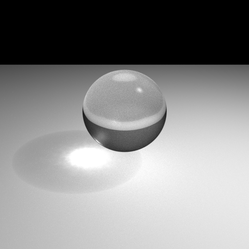

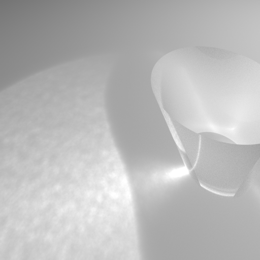

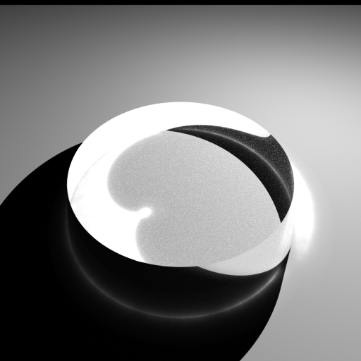
### Features which take a long time to run
- volumetric ray tracing with many overlapping transparent media
- path traced animation
- distributed ray tracing
- caustics
## List of Implemented Features!
```
Approved extra credit implemented:
- creative scene
- adaptive ray termination
- stochastic jittered supersampling
- antialiasing by adaptive supersampling
- translucent emissive objects
- normal mapping
- overlapping objects
- portals
- Lipschitz-continuous implicit surfaces
- solid volumetric textures
- neural network
- animation, plus trailer
- distributed ray tracing
- full path tracing
- volumetric ray tracing
- fresnel shading and cel shading
- caustics
  
Variable extra credit implemented:
- total internal reflection
- fast approximate antialiasing
- sinc filter for texturing
```
