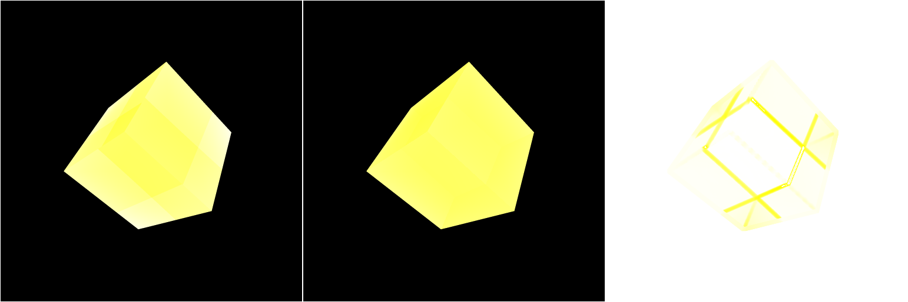
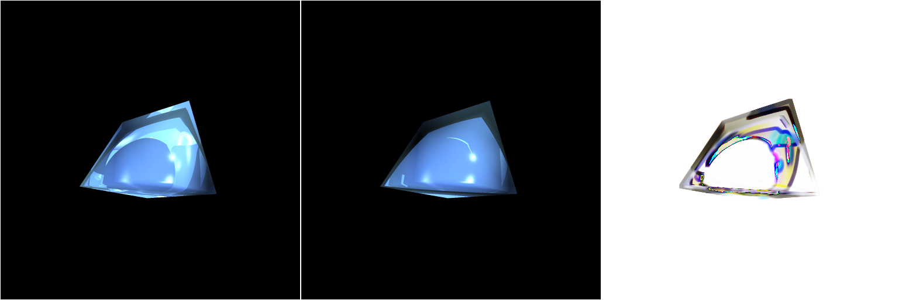
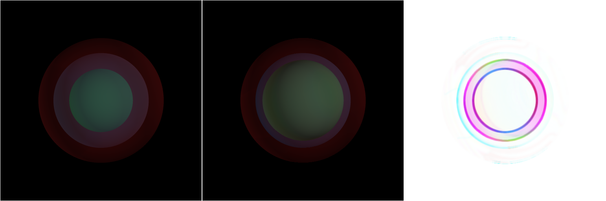
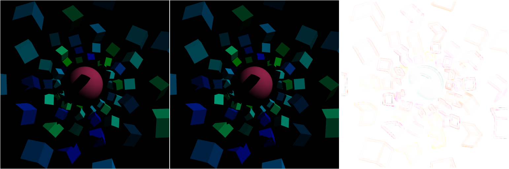
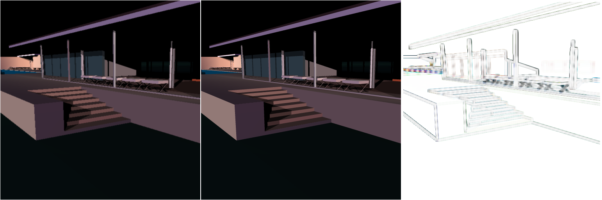

I detail my [Design Decisions](#general-design-decisions) (specifically where I differ from the reference solution) below, as well as my [#Extra Credit](#extra-credit-design-decisions) work here.

Build instructions (these are the normal build instructions):
```bash
mkdir build
cd build
cmake -DCMAKE_BUILD_TYPE=Release ..
make -j8
cd ..
./build/bin/ray # to the run binary from the source directory
```
## General Design Decisions:
### Multithreading:
The `m_threads` variable is set in `main.cpp` and defaults to the number of logical cores. If the json file specifies a number of threads:
```json
{
	"threads": 8
}
```
then `m_threads` will be set to this value. (I have also added a command line flag `-t <thread_count>` to set `m_threads`. It is supported by my binary only and not the reference binary.) My ray tracer has multithreading with OpenMP. The loops in tracePixel and in antialiasing are parallelized with OpenMP compiler directives. 
### Backface Culling
I do **not** implement backface culling, while the reference binary **does** implement backface culling. This causes a discrepancy on the `turtle.json` scene, where one of the trimeshes appears red in the reference binary but black in my solution.
### Pixel centering (in tracePixel and antialiasing):
The reference binary samples at pixel boundaries:  `x = double(i) / buffer_width`, `y = double(j) / buffer_height`.
- For pixel `(i, j)` this gives normalized coordinates `(i/W, j/H)`, which correspond to the top-left corner of the pixel (or the edge between pixel `(i-1)` and `(i)`), not the center of the pixel cell.
So the reference effectively casts one ray per pixel through a corner/edge of the pixel cell. My implementation centers the sample within the pixel:
- **tracePixel:**
`x = (double(i) + 0.5) / buffer_width`,
`y = (double(j) + 0.5) / buffer_height`.
So the single ray for pixel `(i, j)` goes through the center of that pixel’s area in normalized coordinates. Because the reference binary does not use this centering, pixel colors can differ along edges of objects when compared to the reference. Same scene and same resolution will show slight shifts or different edge pixels, especially where a boundary falls between two pixel centers vs two pixel corners.

I do the same pixel centering in my antialiasing methods. More detailed explanations of the extra antialiasing methods are in the extra credit section.
- **Default (supersampling) `aaImage`:**
Subpixel samples are placed at the center of each subcell. For a `gridSize × gridSize` grid over the pixel:
- `offsetX = (double(p) + 0.5) / gridSize`,
- `offsetY = (double(q) + 0.5) / gridSize`,
then `x = (i + offsetX) / buffer_width`, `y = (j + offsetY) / buffer_height`.
	So each of the `gridSize²` samples lies at the center of its subpixel cell, and the pixel is covered by a uniform grid of centered samples. `gridSize` is given by the `m_nSuperSamples` parameter. Default antialiasing is on by default, and can be turned off with the json setting:
```json
{
	"anti_alias": false
}
```
- **Adaptive AA `aaAdaptiveImage` / `aaARecurse`:**
The first level uses the four corners of the pixel (`(i,j)`, `(i+1,j)`, `(i,j+1)`, `(i+1,j+1)` in pixel space) plus the center sample in recursion. So the initial samples are at pixel corners; inside `aaARecurse`, the center of the current quad is always computed as `(x + halfW, y + halfH)`, i.e. the center of that region. So adaptive AA uses corner + center sampling by design for the quadtree, not “all centers” like the default grid.
- **FXAA `aaFastApproxImage`:**
No new rays are cast; it only post-processes the buffer produced by `traceImage`. So “centering” here is whatever was used in `traceImage` (and in the run that feeds FXAA, that is the centered `tracePixel`). FXAA itself only samples and blends existing pixel colors.
### tracePixel and traceRay:
#### tracePixel(i, j):
- Converts pixel indices `(i, j)` to normalized `(x, y)` **at the center of the pixel** (as above).
- Calls `trace(x, y)` to get a color.
- Clamps the result to `[0, 1]` and writes it into the buffer (RGB as `unsigned char`).
- Used by `traceImage`, which runs over all pixels in parallel with OpenMP.
#### traceRay(r, thresh, depth, t):
Given a ray (primary or secondary), computes the color along that ray (direct shading + reflection + refraction), with optional overlap and TIR behavior controlled by flags that I added.
1. **Overlapping translucent objects (handleOverlap):**
If `handleOverlap` is true, the implementation **delegates entirely** to `traceRayOverlap(r, thresh, depth, t, objStack)` with an empty `objStack`. No other branch of `traceRay` is executed. This is explained further in the extra credit section. 
2. **Depth:**
If `depth <= 0`, returns black `(0,0,0)` (recursion limit).
3. **Intersection:**
`scene->intersect(r, i)` finds the first intersection `i` (object, material, normal, `t`, etc.).
4. **If hit:**
- `t = i.getT()` (ray parameter at hit).
- **Direct shading:** `colorC = m.shade(scene.get(), r, i)` — local illumination (diffuse, specular, shadows, etc.).
- **Reflection:** `accumulateReflection(r, i, Kr, thresh, depth, colorC)` adds reflected light (if `Kr > 0`).
- **Refraction:** `accumulateRefraction(r, i, m, Kt, thresh, depth, colorC)` adds transmitted light (if `Kt > 0`), including optional TIR when `tir` is true. This is explained further in the extra credit section.
1. **If no hit:** `t = 0`, `colorC = backgroundColor()` (e.g. black).
2. **Return** `colorC`.
So traceRay is the single place that decides overlap vs non-overlap and then does: intersect → shade → accumulate reflection → accumulate refraction.
### Shading:
`Material::shade` does local Phong (emissive, ambient, diffuse, specular). The base color is just the scene's ambient color combined with the emissive and ambient components of the intersection point. For each light, distance and shadow attenuation and calculated and skipped if effectively zero. They are multipliers on the diffuse and specular term.

Phong shading is defined for opaque surfaces only. For opaque materials, the diffuse reflection is clamped to be greater than 0 (light only when it's on the same side as the normal), for transmissive materials, I take the absolute value so both sides of the surface are diffuse.
- Otherwise, when the camera sees the back of the surface (ex. inside a sphere) the normal can point away from the light and zero out the diffuse term.

The normal is flipped when the light is on the other side, and the reflection vector uses this effective normal so the specular highlight is computed as if the surface faced the light. This way highlights still show on the visible side of glass when the light is behind the surface.
### Light attenuation:
Shadow attenuation for directional and point lights call an overlap function when handling overlapping translucent objects is enabled. This will be explained further in the extra credit section.
### Trimeshes:
I use the barycentric method explained in class.
## Extra Credit Design Decisions:
### Overview:
I implemented four features for extra credit:
1. Total internal reflection. My binary enables this with the `--tir` command line flag. (The reference binary will not support the `--tir` flag.) For example:
	- `./build/bin/ray -r 5 --tir ./extra_credit_scenes/trans.json ./extra_credit_output/trans.png`
2. Handling physically overlapping translucent objects. My binary enables this with the `--handle-overlap` command line flag. (The reference binary will not support the `--handle-overlap` flag.) For example:
	- `./build/bin/ray -r 5 --handle-overlap ./extra_credit_scenes/concentric_spheres.json ./extra_credit_output/concentric_spheres.png`
3. Adaptive antialiasing. My binary enables this with the `--aaa` command line flag. (The reference binary will not support the `--aaa` flag.) For example:
	- `./build/bin/ray -r 5 --aaa ./extra_credit_scenes/hitchcock.json ./extra_credit_output/hitchcock.png`
4. Fast approximate antialiasing. My binary enables this with the `--fxaa` command line flag. (The reference binary will not support the `--fxaa` flag.) For example:
	- `./build/bin/ray -r 5 --fxaa ./extra_credit_scenes/hitchcock.json ./extra_credit_output/hitchcock.png`
### Total Internal Reflection:
Snell's law: $n_{1}\sin(\theta_{1})=n_{2}\sin(\theta_{2}))$
Total internal reflection occurs when we go from a denser to less desnse material, and for a large enough incidence angle, we get that $\sin(\theta_{2})>1$ which is impossible. There is no real refracted ray, the interface reflects all the light. So TIR occurs only when the ray is leaving the denser medium (ex. inside glass, hitting the glass-air boundary) and the angle of incidence is above the critical angle: $\theta_{c}=\arcsin\left( \frac{n_{2}}{n_{1}} \right)$.

When computing the refraction direction (`computeRefractionDirection`), I use the identity $\sin^2(\theta_{transmitted})=\text{iorRatio}^2(1-\cos^2(\theta_{incoming}))$ where the index of refraction ratio is $\frac{n_{1}}{n_{2}}$. Then, if $\sin^2(\theta_{transmitted})>1$, there is no valid refracted direction, so I return a zero vector to indicate that we should take the TIR path when deciding to shoot a refraction ray. So if our refraction direction was a zero vector, and the `--tir` flag is enabled, I compute the reflection direction, trace a reflection ray from the hit point, and attenuate by the path through the material. This logic is implemented also for the `--handle-overlap` path, so you can enable both total internal reflection and handling overlap for a scene.

Here are some examples of my total internal reflection:
1. `trans.json`: My ray tracer with total internal reflection is on the left, the reference solution (which has no total internal reflection) is in the middle. The `trans.json` scene is a given scene, but can also be found in the `extra_credit_scenes` folder. (Again, the scene path is `/ray/extra_credit_scenes/trans.json` and the command to run this, from the `ray` directory is `./build/bin/ray -r 5 --tir ./extra_credit_scenes/trans.json ./extra_credit_output/trans.png`.)

2. `prism.json`: This is a scene I made and it can be found in the `extra_credit_scenes` folder. It sets up transparent triangular prism in front of the camera: the prism is a 6-vertex trimesh (two triangular bases in the z = ±0.5 planes and three rectangular sides), with a glass-like material (index 1.5, transmissive, some diffuse and specular). It’s rotated around the axis [0.3, 1, 0.2] by 0.85 rad so you look through it at an angle. Two directional lights light the scene. The idea is to show rays that hit the prism’s facets from inside at angles steeper than the critical angle are reflected at the glass–air interface instead of leaving, so with the `--tir` flag you see bright edges along the prism and without it those reflections are missing and the edges stay darker. (Again, the scene path is `/ray/extra_credit_scenes/prism.json` and the command to run this, from the `ray` directory is `./build/bin/ray -r 5 --tir ./extra_credit_scenes/prism.json ./extra_credit_output/prism.png`.) My ray tracer with total internal reflection is on the left, the reference solution (which has no total internal reflection is in the middle).

### Handling Physically Overlapping Objects:
With overlap on (`--handle-overlap`), the tracer keeps a stack of objects the ray is currently inside; the primary ray starts with an empty stack (air). At each hit it checks whether the hit object is already in the stack. If it is not, the ray is entering that object, so the object is pushed onto the stack and the surface normal is used as-is for refraction. If the object is in the stack, the ray is leaving it, so that object is removed from the stack and the normal is flipped for refraction. So enter/exit is decided only by the stack, not by the dot product. For refraction, the “current” index is the average of the indices of all objects in the stack (empty stack means air, index 1). The “other side” index is the average over the stack after the push or pop. The refraction ratio is current index over other-side index, so at a boundary between two objects you get the correct ratio between their indices. Path attenuation uses the average transmissive color of the set of objects the ray is traveling through (again from the stack). Reflection does not change which objects the ray is inside, so the same stack is passed along. Refraction passes the updated stack (after push or pop) into the recursive call so the next hit sees the correct “current medium.”

Shadow rays with `--handle-overlap` again keep a stack of objects the ray is inside. At each hit, the segment from the previous point to this hit is first attenuated using the average transmissive color of all objects currently in the stack and the segment length; if the stack is empty (air) that step is skipped. Then the hit object is either added to the stack if it was not there (entering) or removed if it was (exiting). So the attenuation for each segment uses the combined effect of every object the ray was inside along that segment, which matches the overlap logic in the raytracer and gives correct colored shadows through stacked objects.

Here are some examples of my overlapping objects:
1. `concentric_spheres.json`: This is a scene I made and it can be found in the `extra_credit_scenes` folder. The scene is three transparent spheres sharing the same center at the origin. The outer one is the unit sphere, the middle is scaled by 0.7, and the inner by 0.4. Each has a different index of refraction (1.1, 1.5, and 2) and a different transmissive tint (reddish, bluish, greenish). The camera looks at them from the positive X side with two directional lights and some ambient. The reference solution does not implement this correctly, and the innermost sphere displaces the middle sphere. My ray tracer does show all three concentric colored spheres equally spaced.
	- `./build/bin/ray -r 5 --handle-overlap ./extra_credit_scenes/concentric_spheres.json ./extra_credit_output/concentric_spheres.png`

2. `red_blue_spheres.json`: This is a scene I made and it can be found in the `extra_credit_scenes` folder. There are two transparent spheres on a white floor, one has a red transmissive tint and the other has a blue transmissive tint. The spheres overlap physically in the center. The overlapping region should have a combined color and shadow, which the reference solution does not implement.
	- `./build/bin/ray -r 5 --handle-overlap ./extra_credit_scenes/red_blue_spheres.json ./extra_credit_output/red_blue_spheres.png`

3. `overlapping_shadows.json`: This is a scene I made and it can be found in the `extra_credit_scenes` folder. Two transparent spheres are overlapping, and the scene is meant to stress shadow rays through the overlap. The shadow attenuation should use the combined (averaged) transmissive color of both (not done correctly in the reference implementation).
	- `./build/bin/ray -r 5 --handle-overlap ./extra_credit_scenes/overlapping_shadows.json ./extra_credit_output/overlapping_shadows.png`

4. `cylinder_box.json`: This is a scene I made and it can be found in the `extra_credit_scenes` folder. There are two overlapping transparent objects, one is a cyan box and the other is a yellow cylinder. Their shadow on the wall behind them should be black, while the overlapping section should be green. The reference solution does not implement the overlap correctly.
	- `./build/bin/ray -r 5 --handle-overlap ./extra_credit_scenes/cylinder_box.json ./extra_credit_output/cylinder_box.png`

### Advanced Antialiasing Methods
For reference, I ran `hitchcock.json` and `hotel.json` on all my different aliasing methods, these are the baseline (no antialiasing) and default supersampled aliasing results:

`hitchcock.json` without antialiasing:
- `{"anti_alias"=false}` as a `settings.json`
- `./build/bin/ray -r 5 -j settings.json ./extra_credit_scenes/hitchcock.json ./extra_credit_output/hitchcock.png`

The total time to render my image was 0.54 seconds, and there were ~3.53M rays traced.

`hitchcock.json` with default, supersampled antialiasing:
-  `./build/bin/ray -r 5 ./extra_credit_scenes/hitchcock.json ./extra_credit_output/hitchcock.png`

The total time to render my image was 4.07 seconds, and there were ~353K rays traced.

`hotel.json` without antialiasing:
- `{"anti_alias"=false}` as a `settings.json`
- `./build/bin/ray -r 5 -j settings.json ./extra_credit_scenes/hotel.json ./extra_credit_output/hotel.png`

The total time to render my image was 11.9 seconds, and there were ~2.52M rays traced.

`hotel.json` with default, supersampled antialiasing:
-  `./build/bin/ray -r 5 ./extra_credit_scenes/hotel.json ./extra_credit_output/hotel.png`

The total time to render my image was 165.86 seconds, and there were ~25.3M rays traced.

#### Adaptive Antialiasing
I set up parallelism by processing the image over rows using OpenMP, treating each pixel (i,j) as an independent 1×1 region in pixel space that I normalize to camera coordinates during ray tracing. I trace rays through the four corners of the pixel to initialize a quadtree subdivision. For each region, I trace a ray through the center (x+w/2,y+h/2) and calculate variation based on the Euclidean distance between the center and corner colors in RGB space. If these distances fall below `aaThresh` or the maximum depth is reached, the average of the five samples is returned (corners plus center); otherwise, I subdivide the region into four quadrants by sampling the edge midpoints, recursively process these subregions using efficient sample reuse, and average their results to produce a final color that I clamp to [0,1] and write to the buffer.

`hitchcock.json` with `--aaa`:
- `./build/bin/ray -r 5 --aaa ./extra_credit_scenes/hitchcock.json ./extra_credit_output/hitchcock.png`

The total time to render my image was 2.86 seconds, and there were ~2.54M rays traced.

`hotel.json` with `--aaa`:
 - `./build/bin/ray -r 5 --aaa ./extra_credit_scenes/hotel.json ./extra_credit_output/hotel.png`

The total time to render my image was 121.40 seconds, and there were ~19.1M rays traced.

#### Fast Approximate Antialiasing
I implement fast approximate antialiasing method as a post-process filter that runs in parallel over the image without casting additional rays. To ensure deterministic results and avoid feedback loops, I first freeze the input by creating a full snapshot of the current RGB buffer; all reads come from this copy while writes go to the original. For every pixel $(i,j)$, I convert the color to floating-point luminance using standard weights ($Y=0.299R+0.587G+0.114B$) (equation from BT.601) and check for edges by gathering a 5-pixel cross neighborhood (center, north, south, east, west). I calculate the local contrast as the difference between the maximum and minimum luminance in this neighborhood ($contrast = Y_{max} - Y_{min}$), and ignore any areas where the contrast falls below a low threshold of approximately $1/255$.

When I detect an edge (where contrast exceeds the threshold), I apply a low-pass filter by averaging the five neighboring colors to create a blurred target: $filtered = (c + c_N + c_S + c_E + c_W) / 5$. I then determine how much to blend this blurred result with the original pixel by calculating a normalized blend factor $b = \frac{contrast}{contrast + threshold}$ (scaled by 0.9), effectively merging the two via linear interpolation: $final = (1-b)c + b \cdot filtered$. Finally, I clamp the result to $[0,1]$ and write it back to the buffer.

`hitchcock.json` with `--fxaa`:
-  `./build/bin/ray -r 5 --fxaa ./extra_credit_scenes/hitchcock.json ./extra_credit_output/hitchcock.png`

The total time to render my image was 0.63 seconds, and there were ~353K rays traced.

`hotel.json` with `--fxaa`:
-  `./build/bin/ray -r 5 --fxaa ./extra_credit_scenes/hotel.json ./extra_credit_output/hotel.png`

The total time to render my image was 12.62 seconds, and there were ~2.52M rays traced.
#### Comparison
In the `hitchcock` scene, the efficiency of my implementations is the main differentiator. FXAA is extremely fast (0.63s), taking almost the same amount of time as the raw render (0.54s) because it operates purely as a post-process filter without casting a single extra ray. However, this speed comes at the cost of precision; jagged edges are merely blurred rather than resolved. Supersampling took nearly 8 times longer (4.07s) because it blindly oversamples every pixel. Adaptive Antialiasing provided a middle ground (2.86s), reducing the time needed compared to supersampling, but it was still significantly slower than the post-process approach.

The complex `hotel` scene highlights the scalability of these methods. Supersampling was computationally heavy, taking roughly 166 seconds and casting over 25 million rays to resolve the geometry. My Adaptive method successfully optimized this by pruning flat areas, saving about 45 seconds and 6 million rays compared to the brute-force approach. In contrast, FXAA finished in just 12.6 seconds, barely slower than the base render (11.9s), and kept the ray count identical at 2.52M. While FXAA is the only method that remains fast regardless of scene complexity, it sacrifices the subpixel accuracy that the other aliasing methods provide.